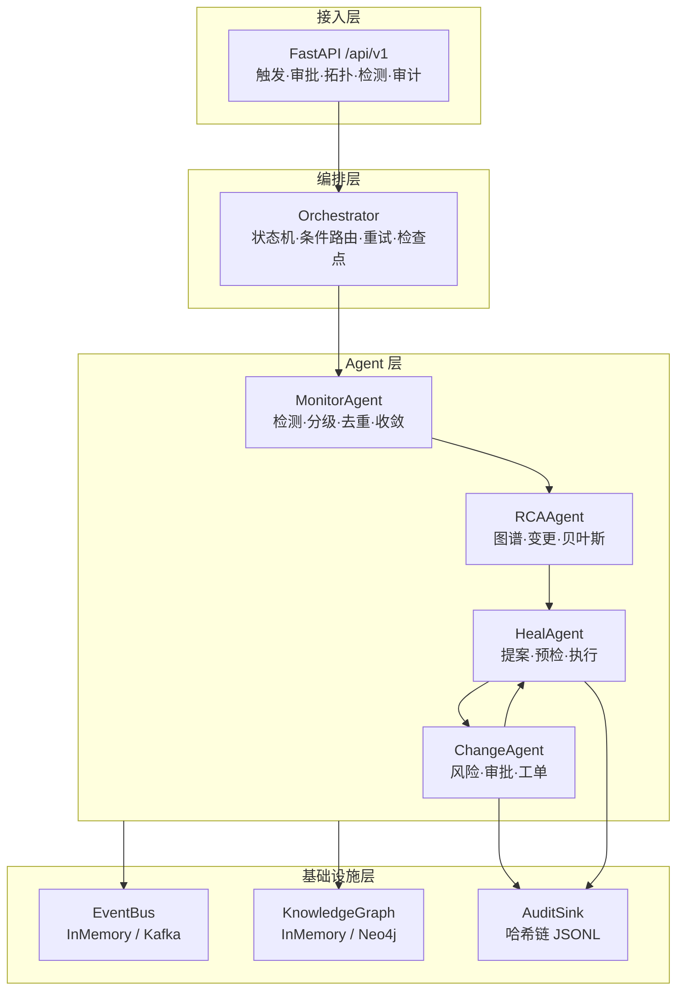
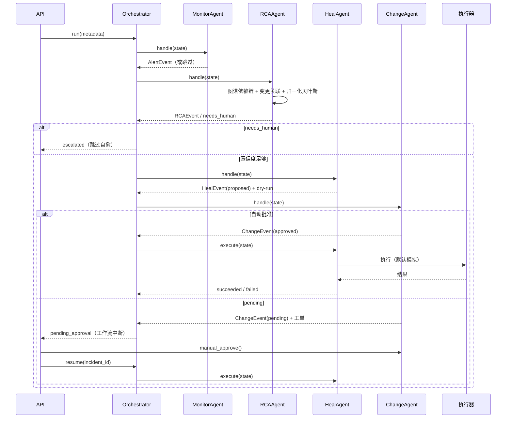

# 架构说明

> 本文描述的是**仓库里真实存在的实现**，不是规划稿。
> 规划中但尚未落地的部分统一放在第 9 节「扩展点」。

---

## 1. 目标与范围

**目标**：在 MySQL 一主两从 + 代理层的拓扑下，把一次数据库故障从「告警」推进到「审批后执行」，并保证三件事：

1. 证据不足时不动手；
2. 没有审批单不执行；
3. 每一步都能在审计链里查到。

**非目标**：不做通用 APM、不做 LLM 推理、不替代 DBA 做 L2 决策、不直接连生产库执行。

---

## 2. 组件与职责



| 组件 | 只做一件事 | 不做的事 |
|------|-----------|---------|
| MonitorAgent | 判断「这个点是不是异常」 | 不判断根因、不执行 |
| RCAAgent | 给出候选根因、证据、置信度 | 不选修复方式 |
| HealAgent | 把根因映射成 Playbook 并预检 | 不在没有审批时执行 |
| ChangeAgent | 算风险、走审批、留审计 | 不执行命令 |
| Orchestrator | 按条件推进节点、重试、检查点 | 不含业务判断 |

---

## 3. 一次故障的时序



---

## 4. 数据模型

所有事件都带 `event_id`、`correlation_id`、`timestamp`、`source_agent`。

| 事件 | 关键字段 | 产生者 |
|------|---------|--------|
| `AlertEvent` | metric、value、severity、votes、dedup_key | Monitor |
| `RCAEvent` | root_cause_type、confidence、evidence、affected_services、needs_human | RCA |
| `HealEvent` | playbook、command、blast_radius、status、dry_run_result、execution_result | Heal |
| `ChangeEvent` | risk_score、risk_factors、policy、approval_status、ticket_id、audit_log | Change |
| `IncidentState` | 上述事件的容器 + timeline + metadata | Orchestrator |

`HealEvent.status` 是执行阶段的唯一事实来源，取值：
`proposed → approved / rejected → succeeded / failed`。
`execute()` 只接受 `approved`，并在已 `succeeded/failed` 时做幂等跳过。

---

## 5. 工作流状态机

| 当前状态 | 触发 | 下一状态 |
|---------|------|---------|
| open | monitor 检测到异常 | investigating |
| investigating | rca 置信度 ≥ 0.30 且领先 ≥ 0.05 | proposing |
| investigating | 证据不足 | escalated（终止） |
| proposing | heal 找到 Playbook | pending_approval |
| proposing | 无 Playbook / 预检失败 | escalated（终止） |
| pending_approval | change 自动批准 | approved → executing |
| pending_approval | change 挂起 | pending_approval（等 resume） |
| pending_approval | 人工拒绝 | rejected（终止） |
| executing | 执行成功 | resolved |
| executing | 执行失败 | failed（尝试回滚，熔断计数 +1） |
| 任意 | 节点重试耗尽 | failed（终止，不再执行后续节点） |

关键点：**节点失败即终止**。原实现会在 RCA 失败后继续执行自愈，等于在错误信息上动手。

---

## 6. 算法说明

### 6.1 异常检测

- 每个指标一份 `MetricPolicy`：方向（upper/both）、warn、crit、min_history；
- MAD 用中位数和 MAD 做鲁棒标准化，避免历史尖刺污染基线；
- Isolation Forest 需要至少 50 个历史点，否则弃权；
- 投票只统计「有结论」的算法，小于 2 票不报警；
- 冷启动不足 20 点时，Monitor 只记历史，不产生告警。

### 6.2 根因

```
candidates = FAULT_CATALOG[metric]
evidence   = [指标异常] + [24h 变更] + [共置主机] + [长事务/慢查询/日志]
weight_i   = prior_i × likelihood_i
posterior  = weight_i / Σ weight
```

`likelihood` 由证据类型是否命中决定：例如 `replica_ddl` 需要 24h 内存在 `ddl` 类型变更，
命中给 0.9，否则 0.25。置信度或领先差距不足时标记 `needs_human`。

### 6.3 风险评分

见 README 6.4 节的 6 因子表。风险分只决定「走哪条审批路径」，不决定是否执行；
最终执行权始终在 ChangeEvent 的 `approval_status` 上。

---

## 7. 安全与合规

| 机制 | 实现位置 | 作用 |
|------|---------|------|
| 审批门禁 | `HealAgent.execute` | 没有 approved 变更单直接抛 `PermissionError` |
| 爆炸半径 | `HealAgent.propose` | 超过 0.20 强制升级 L2 |
| 命令白名单 | `CommandExecutor.preflight` | 只允许 mysql/pt-kill/gh-ost/orchestrator 等前缀 |
| 危险模式 | `CommandExecutor.preflight` | 拦截 DROP TABLE、rm -rf、管道、命令替换 |
| 幂等 | `HealAgent.execute` | 已执行过的 action 直接跳过 |
| 熔断 | `CircuitBreaker` | 连续失败 5 次暂停自动修复，60s 后半开 |
| 回滚 | `HealAgent.execute` | 失败时执行 `rollback_command` |
| 审计链 | `AuditSink` | 哈希链 + 跨文件校验，可定位篡改行 |

---

## 8. 失败模式与对策

| 失败模式 | 当前对策 | 仍存在的风险 |
|---------|---------|-------------|
| RCA 证据不足 | needs_human，跳过自愈 | 需要人工兜底 |
| 审批长时间不处理 | 工作流挂起，工单可查 | 没有超时自动升级（TODO） |
| 执行器超时 | 抛错 → failed → 回滚 → 熔断 | 模拟执行器不覆盖真实超时 |
| Kafka 不可用 | 可选内存总线 | 生产需重试与 DLQ 监控 |
| Neo4j 不可用 | 默认内存图谱 | 多副本图谱一致性未处理 |
| 服务重启 | 审计已落盘 | 检查点在内存，会丢 |
| 重复触发同一告警 | 指纹 300s 去重 + 服务级收敛 | 多实例部署时去重不共享 |

---

## 9. 扩展点

1. **LLM 辅助**：RCA 已输出结构化的假设、证据和置信度，可在候选排序/摘要处接 LLM，而不是让它直接生成命令。
2. **真实执行**：`SubprocessExecutor` 已实现，默认关闭；开启前需要补超时、审计和权限隔离。
3. **Kafka / Neo4j**：适配层已写，需在有 broker 的环境联调，并补消费者组监控。
4. **检查点持久化**：把 `_checkpoints` 写到 Redis/Postgres，支持进程重启恢复。
5. **多实例**：去重指纹、熔断状态、审批锁需要外置到共享存储。

---

## 10. 性能口径

- 30 次端到端回放：p50 69.8ms，p95 72.2ms；
- 主要开销是每个采样点的 Isolation Forest 在线拟合；
- 不含真实数据库执行、Kafka 网络、人工审批等待；
- 单进程 asyncio，未做并发压测，不能外推为生产吞吐。
